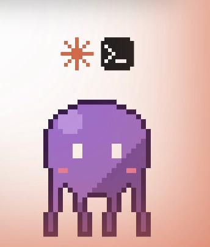
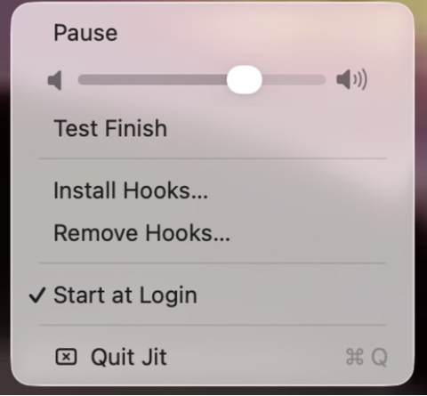

# Jit

A tiny pixel squid that lives on the bottom edge of your Mac and chimes when Claude Code or Codex finishes.

<p align="center">
  
</p>

## What it does

Jit is a small native macOS app. A 32×32 pixel squid hangs just below the bottom edge of your main screen, peeking over it with his tentacles gripping the edge and blinking now and then. When a Claude Code or Codex task finishes, Jit plays a short chime, jumps up, and floats above the edge with a mark showing which tool finished. He stays up until you click him, so you can't miss a finished task even if you were away.

- One chime for both tools, generated in code, with its own volume slider.
- A small mark per finished tool: an orange spark for Claude Code, a terminal prompt for Codex.
- Click Jit to clear the marks and send him back to peeking. Double-click to bring him up or send him back down, in any Space.
- Ducks into his peek when you switch to a fullscreen app, and comes back up when you leave it. A task finishing still brings him up, even in fullscreen.
- Pause from the menu bar: finished tasks still count and show up when you resume.
- Clicks pass through everywhere except the squid, and Jit never takes focus.
- Bring your own 32×32 sprite.

| Peeking | Finished tasks | Menu bar |
| :---: | :---: | :---: |
|  |  |  |

## Requirements

- macOS 14 Sonoma or later
- Xcode (to build Jit)
- [Claude Code](https://docs.claude.com/en/docs/claude-code) and/or [Codex](https://developers.openai.com/codex) installed

## Setup

1. Clone the repo:

   ```bash
   git clone https://github.com/deniz0balakrishnan-creator/Jit.git
   ```

2. Open `Jit.xcodeproj` in Xcode, pick the **Jit** scheme and **My Mac**, then choose **Product > Run** (⌘R). The project signs to run locally, so no Apple developer team is needed.
3. Allow any prompts macOS shows. You'll see a notification that Jit was added to your login items (Start at Login is on by default).
4. Jit asks once whether to install its hooks. Click **Install Hooks**, or later use **Install Hooks…** in the squid menu in the menu bar. It adds a `Stop` hook to `~/.claude/settings.json` and `~/.codex/config.toml`, writing a timestamped backup of each file first.
5. Codex only: Codex runs new hooks only after you trust them. Start `codex` in a terminal, type `/hooks`, and trust Jit's `Stop` hook.
6. Click **Test Finish** in the menu. You should hear the chime, see Jit jump up, and see both marks. Click Jit to clear them.
7. Run a real task in Claude Code or Codex. When it finishes, Jit chimes and jumps up with that tool's mark. Claude Code loads hooks when a session starts, so use a new session.

## Using your own sprite

Jit takes any 32×32 PNG with a transparent background.

- Give it bright eyes: Jit finds the eyes as the brightest pixels, blinks by closing them, and peeks with everything down to just below them.
- Put the feet (or tentacle tips) on the bottom rows: the paws that grip the screen edge take their colors from there.

Keep the file outside Desktop, Documents and Downloads. macOS asks before an app reads those folders, and Jit waits on that prompt before it appears.

Point Jit at it, then quit Jit from its menu and run it again:

```bash
defaults write com.denizbalakrishnan.Jit spritePath ~/Pictures/my-sprite.png
```

To go back to the built-in sprite:

```bash
defaults delete com.denizbalakrishnan.Jit spritePath
```

If your art is bigger pixel art on a flat background, `tools/convert_sprite.py` removes the background, finds the pixel size, and shrinks it to 32×32 (needs Python with Pillow and NumPy):

```bash
python3 tools/convert_sprite.py my-art.png my-sprite.png my-sprite-preview.png
```

## How it works

```
Claude Code / Codex finishes a turn
  → its Stop hook runs:  jit notify --tool claude|codex
  → the jit helper sends {"tool":"claude"} over a Unix socket
     (~/Library/Application Support/Jit/jit.sock)
  → Jit plays the chime, jumps up, and shows the mark
```

- **Install Hooks** copies the `jit` helper to `~/Library/Application Support/Jit/jit`, so the hooks keep working wherever Xcode builds the app.
- If Jit isn't running, the helper exits silently with status 0, so it never breaks Claude Code or Codex.
- **Remove Hooks** takes out only Jit's entries (again backing up each file first) and leaves everything else alone.

## Troubleshooting

- **Nothing happens when a task finishes.** Click **Test Finish**. If that works, the hooks aren't running:
  - Click **Install Hooks…** again. It reports what it found.
  - Start a new Claude Code session (running sessions keep the hooks they started with).
  - For Codex, trust the hook in `/hooks`.
- **Test Finish does nothing.** Jit may be paused: if the menu says **Resume**, click it.
- **Jit isn't running.** Look for the squid icon in the menu bar. If it's missing, run Jit again from Xcode. While Jit is off, the hooks do nothing and cause no errors.
- **No sound.** Check the volume slider in Jit's menu and your Mac's output volume. Pausing also silences the chime.
- **Jit doesn't appear after you set a custom sprite.** macOS may be waiting for you to allow Jit to read the folder the sprite is in. Allow it, or move the sprite out of Desktop, Documents and Downloads.
- **Check the pipe by hand.** This should chime and bring him up:

  ```bash
  "$HOME/Library/Application Support/Jit/jit" notify --tool claude
  ```

## Credit and license

Jit is by Deniz Balakrishnan and is released under the [GNU General Public License v3.0](LICENSE).

If you build on Jit, keep the license and copyright notices, and link back to this repo: https://github.com/deniz0balakrishnan-creator/Jit
